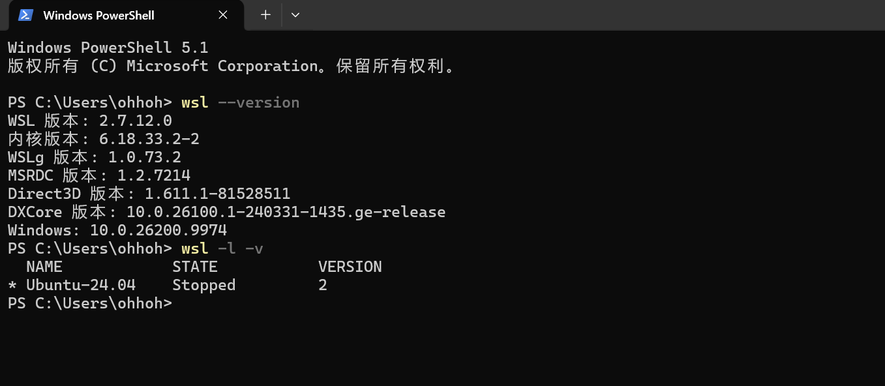
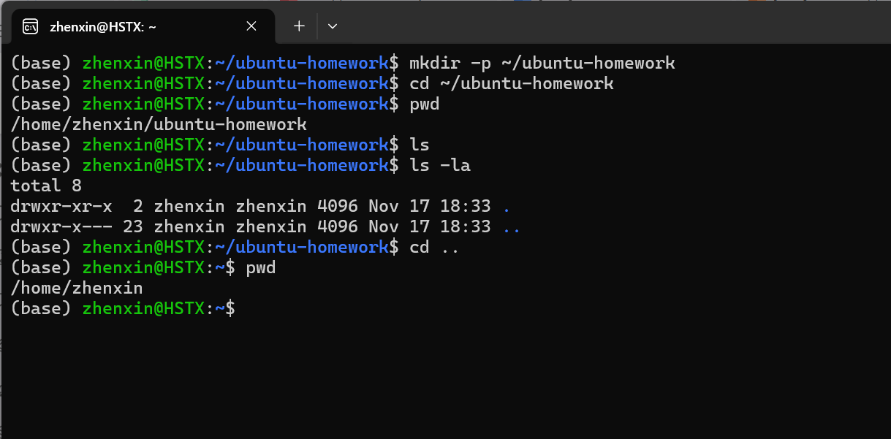
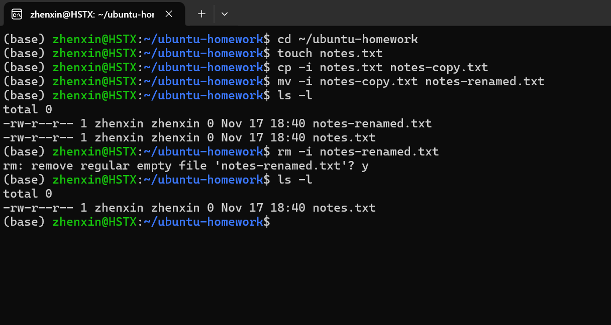
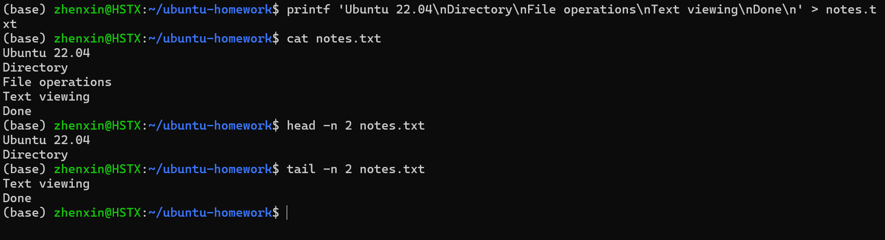
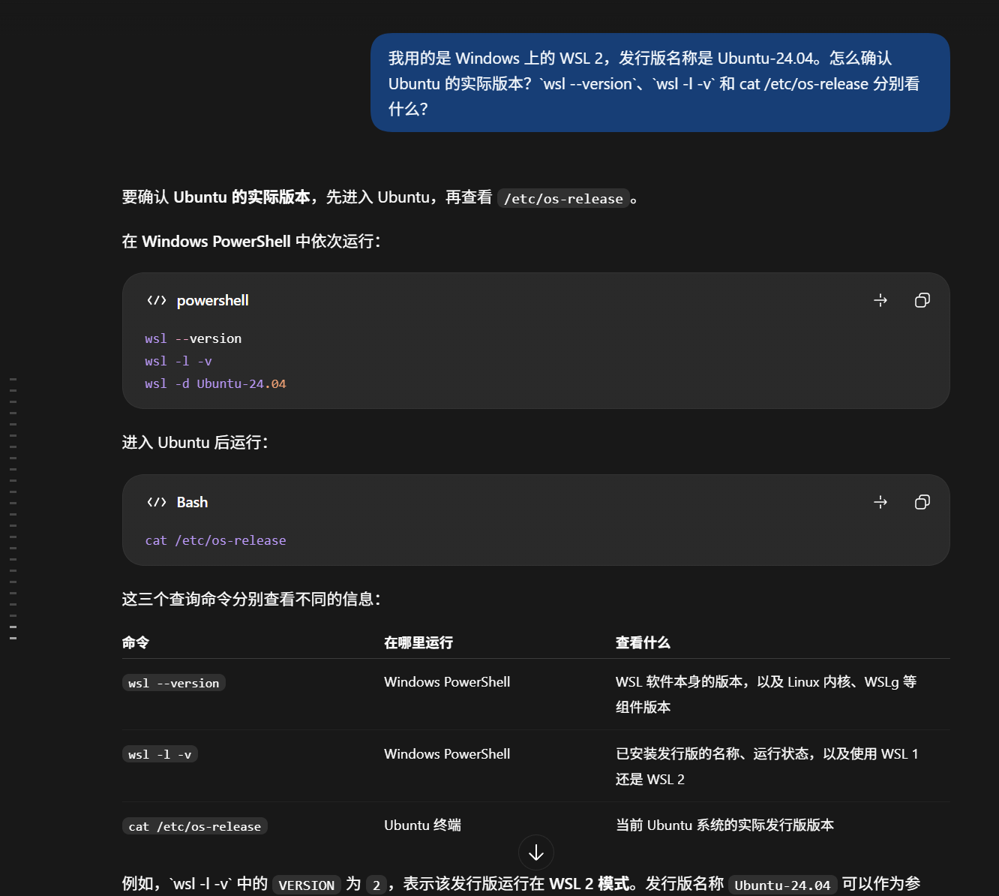

# 第二课作业 · Ubuntu 命令与 Agent 实践

## 基本信息

- 姓名：孙金硕
- 宿主机系统：Windows，截图显示系统内部版本 10.0.26200.9974
- 使用环境：WSL 2，Ubuntu 24.04
- WSL 程序版本：2.7.12.0
- Agent 工具：Codex，本次对话用于操作说明、环境选择讨论及报告整理
- 练习目录：/home/zhenxin/ubuntu-homework

本次使用已有的 WSL 2 Ubuntu 24.04 环境进行命令练习。课程说明要求 Ubuntu 22.04，本次环境存在版本差异，接受情况待教师确认。

## 命令练习与截图

### 环境信息

截图中 wsl -l -v 显示发行版名称 Ubuntu-24.04、运行模式 VERSION 为 2。需补充 Ubuntu 内 cat /etc/os-release 的输出，以进一步核对发行版版本。

### 目录定位

在专用目录练习 mkdir -p、cd、pwd、ls、ls -la 和 cd ..。两次 pwd 分别显示练习目录及其上一级，ls -la 显示详细目录信息。

### 文件操作

创建 notes.txt，复制为 notes-copy.txt，再改名为 notes-renamed.txt。执行 rm -i 后输入 y 确认删除副本，再次用 ls -l 核对，原始 notes.txt 仍在。

### 文本查看

通过 printf 给 notes.txt 写入五行内容，再用 cat 查看全部文本，用 head -n 2 和 tail -n 2 分别查看前两行和后两行。截图中的 Ubuntu 22.04 是练习文本内容，实际环境按上述 Ubuntu 24.04 记录。

## Agent 辅助过程

Codex 帮助梳理了环境核对、三组命令练习和 GitHub 提交流程，并解释了 WSL 与 Docker 的关系。

截图记录了询问 Ubuntu 实际版本的过程，以及 Codex 对三个版本查询命令的解释。

## 心得体会（根据实际操作整理的草稿，请本人核对修改）

这次我在已有的 WSL 2 Ubuntu 24.04 环境里练习了目录、文件和文本操作。Agent 帮我整理了命令顺序和截图要求，我在终端执行命令，并通过回显检查结果。环境核对时需要分清 WSL 的运行模式和 Ubuntu 的版本，练习文件里写入的版本文字也要和系统信息区分开。文件操作中，我用两次 ls 对比删除前后的结果，确认删掉的是副本。cat、head 和 tail 展示了同一文件的不同部分，让我更容易记住它们的用途。以后使用 Agent 给出的命令时，我会先确认所在目录和操作对象，再看结果是否符合预期。

## 提交前待完成

- 补充 Ubuntu 内 cat /etc/os-release 的真实截图。
- 补充至少一张 Agent 辅助过程截图。
- 本人修改并确认心得内容，向教师确认 WSL 2 Ubuntu 24.04 环境是否接受。
- 本人检查改动后完成 commit、push 和 PR，PR 标题为「第二课作业：孙金硕」。
