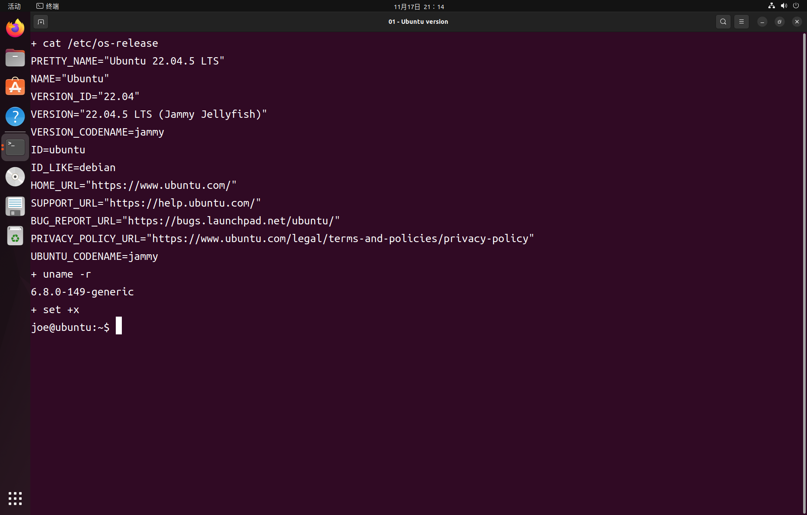
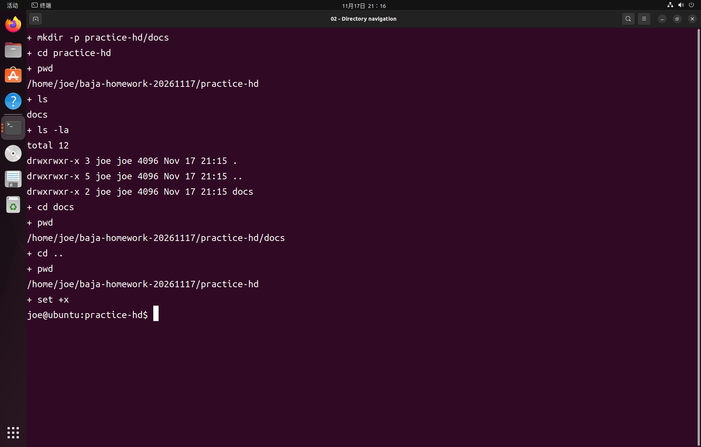
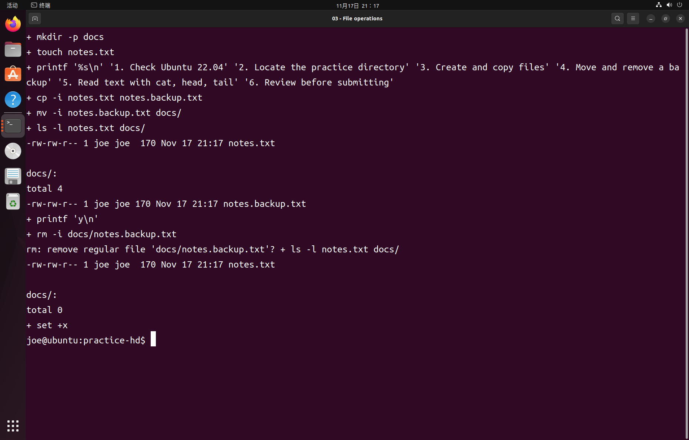
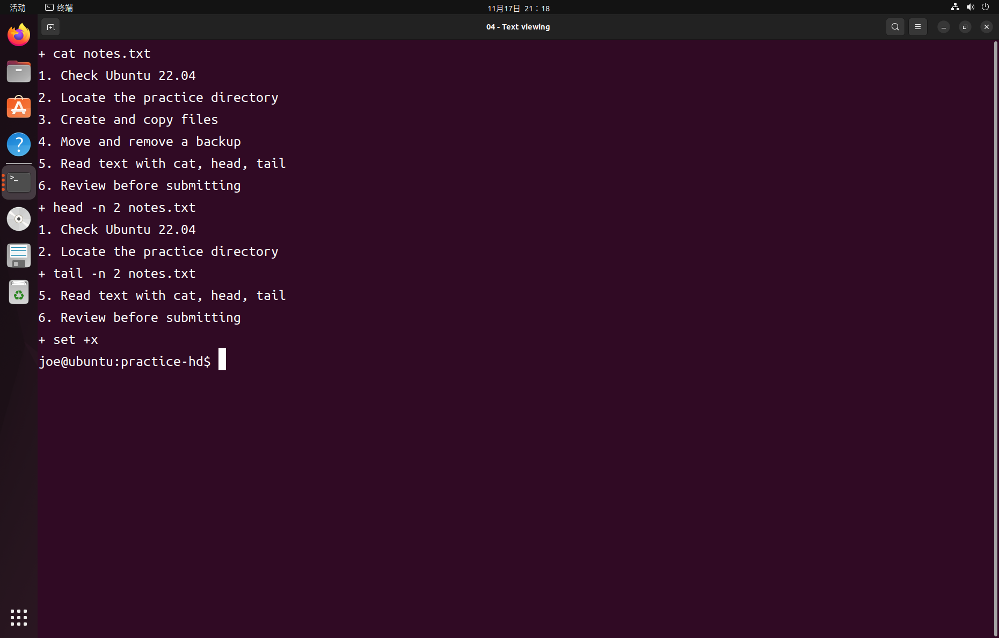
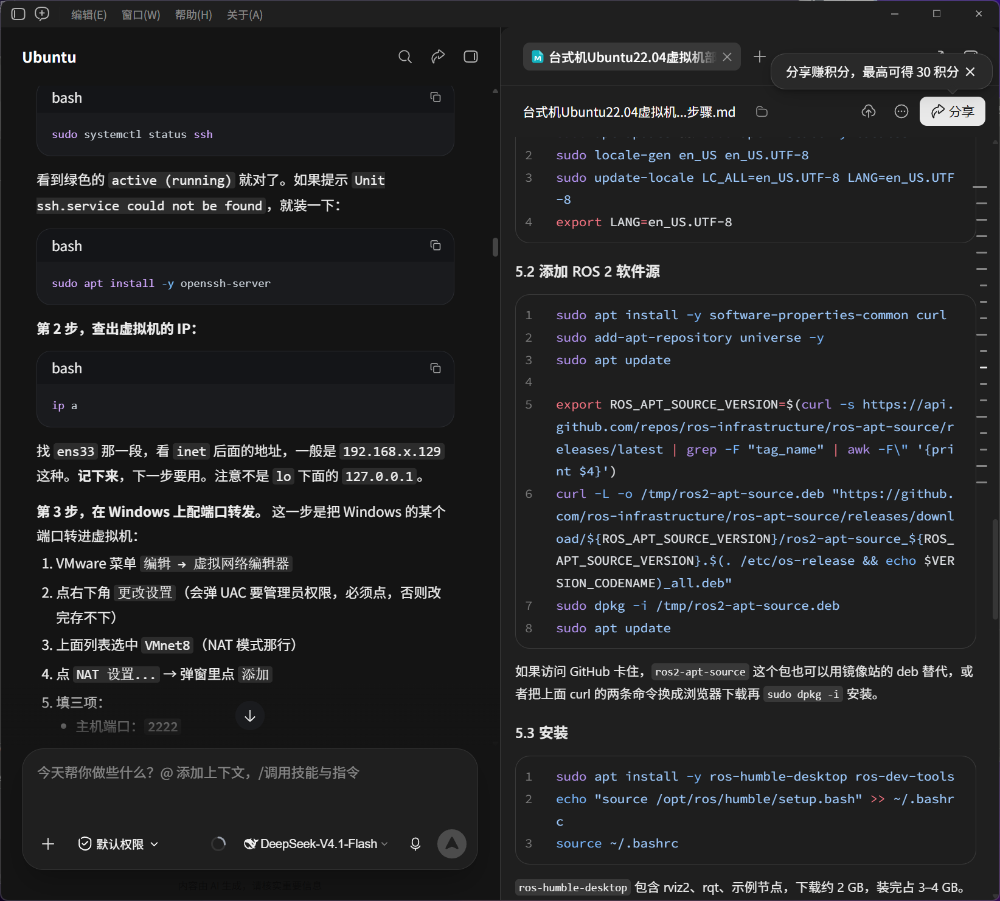

# 第二课作业：Ubuntu 环境搭建与 Agent 实践

## 基本信息

| 项目 | 内容 |
| --- | --- |
| 姓名 | 宋金贤 |
| 日期 | 2026 年 11 月 17 日 |
| 宿主机系统 | Windows，64 位 |
| 环境方式 | VMware 虚拟机 |
| Ubuntu 版本 | Ubuntu 22.04.5 LTS，`VERSION_ID="22.04"` |
| 内核版本 | `6.8.0-149-generic` |
| Agent 工具 | Codex 桌面端及随附 Codex CLI 执行框架；环境配置阶段的 Agent 对话截图标示模型为 DeepSeek-V4.1-Flash |
| 练习目录 | `/home/joe/baja-homework-20261117/practice-hd` |

本次在已安装的 VMware Ubuntu 环境中开展练习。环境配置阶段借助 Agent 理解 SSH 服务检查、虚拟机地址识别和端口转发；后续由 Codex 协助核对版本、排查桌面黑屏、执行命令练习并整理操作记录。我手动登录 Ubuntu 图形桌面，确认桌面能够正常显示。

## 命令练习与截图

01—04 和 07 为 Ubuntu 桌面终端实际执行命令后的截图，终端文字已放大。行首的 `+` 为 Bash 命令执行跟踪标记，其后是实际执行的命令，下方为输出。Ubuntu 实操图片由 VMware 导出为 1861×1189 的原始 PNG；05 为环境配置阶段的 Agent 对话截图。

| 文件 | 练习内容 | 实际结果 |
| --- | --- | --- |
| [01_Ubuntu版本.png](01_Ubuntu版本.png) | `cat /etc/os-release`、`uname -r` | 确认 Ubuntu 22.04.5 LTS 和内核版本 |
| [02_目录定位.png](02_目录定位.png) | `pwd`、`ls`、`ls -la`、`cd`、`cd ..` | 进入 `docs` 子目录并返回，路径输出与切换一致 |
| [03_文件操作.png](03_文件操作.png) | `mkdir -p`、`touch`、`cp -i`、`mv -i`、`rm -i` | 创建文本并复制、移动备份；删除备份后，原文本保留，`docs/` 为空 |
| [04_文本查看.png](04_文本查看.png) | `cat`、`head -n 2`、`tail -n 2` | 分别显示文本全部六行、前两行和后两行 |
| [05_Agent过程.png](05_Agent过程.png) | Agent 对环境配置的指导 | 展示 SSH 服务检查、虚拟机 IP 识别及 VMware NAT 端口转发的操作说明 |
| [06_VMware桌面.png](06_VMware桌面.png) | Ubuntu 图形桌面 | 桌面及终端正常显示 |
| [07_VMware终端核验.png](07_VMware终端核验.png) | 再次核对版本、路径和文件 | 原文本为 170 字节、6 行，备份目录为空 |

### Ubuntu 版本

### 目录定位

### 文件操作

### 文本查看

### Agent 辅助过程

## 遇到的问题与处理

虚拟机启动后曾出现桌面黑屏，但 SSH 仍可连接。Agent 检查显示管理服务和桌面进程后，执行 `sudo systemctl restart gdm3`，恢复了登录界面。我随后手动登录，确认 Ubuntu 桌面正常，并在桌面终端中完成版本和文件核验。

文件操作练习由 Agent 在专用目录中协助执行。删除对象仅为本次创建的 `docs/notes.backup.txt`，通过 `printf 'y\n' | rm -i docs/notes.backup.txt` 提供确认输入。随后再次列出文件，确认 `notes.txt` 保留、备份已移除。

## 学习心得

刚开始接触 Ubuntu 时，我连装双系统还是虚拟机都拿不准。和 Agent 讨论后，考虑到目前主要是学习，我选择了 VMware，并按提示完成安装和登录。过程中，终端粘贴不了、输入密码看不到，还有 VS Code 连接时一直卡着，都让我有点懵。Agent 把步骤拆开，告诉我终端要用 Ctrl+Shift+V 粘贴，密码不显示是正常的，再带着我处理连接问题。这次感觉 Agent 能帮我少走弯路，但照着做完还不等于学会了。现在很多命令我还记不住，之后想多练几遍，慢慢弄懂每一步是在做什么。
