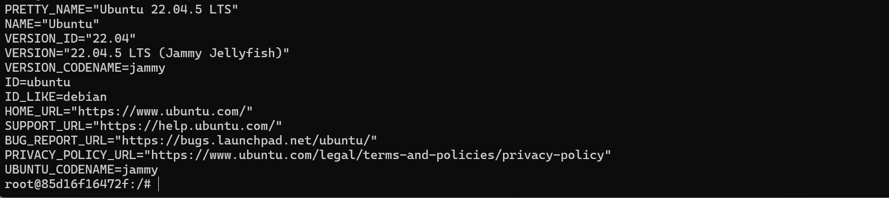
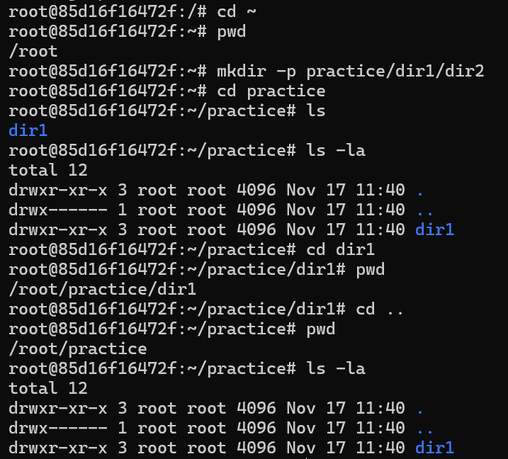
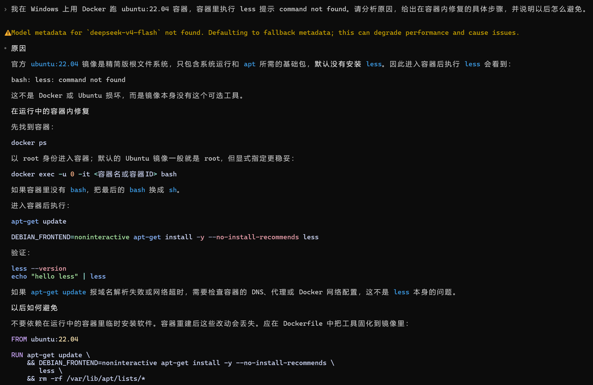

#

```
# 第二课作业：Ubuntu 环境搭建与命令练习

- **姓名**：李恩沛
- **宿主机系统**：Windows 11
- **环境方式**：Docker 容器（Docker Desktop v4.99，WSL 2 后端）
- **Ubuntu 版本**：Ubuntu 22.04.5 LTS（`VERSION_ID="22.04"`）
- **Agent 工具**：OpenAI Codex CLI

## 一、环境搭建结果

在 Docker Desktop 中启动 `ubuntu:22.04` 容器（容器名 `ubuntu2204`），在容器内执行 `cat /etc/os-release` 确认版本：



输出中 `PRETTY_NAME="Ubuntu 22.04.5 LTS"`、`VERSION_ID="22.04"`，确认容器内系统为 Ubuntu 22.04 LTS，符合课程要求。

## 二、命令练习

所有练习均在容器内的 `/root/practice` 目录进行，只操作自己创建的文件。

### 1. 目录定位

使用 `pwd` 确认当前路径，`mkdir -p` 递归创建目录，`cd` / `cd ..` 切换层级，`ls` 与 `ls -la` 对比查看普通列表和含隐藏文件、权限位的详细列表。从 `pwd` 输出的变化可以清楚看到目录层级的切换过程。



### 2. 文件操作

使用 `touch` 创建文件，`cp -i`、`mv -i`、`rm -i` 在覆盖或删除前均触发确认提示，输入 `y` 后才执行。前后两次 `ls -la` 显示了文件被删除后的变化。


### 3. 文本查看

使用 `seq` 生成 1 到 20 的文本文件，分别用 `cat` 查看全部内容、`head -n 5` 查看前五行、`tail -n 5` 查看后五行，并用 `less` 分页浏览后按 `q` 退出。


## 三、Agent 辅助过程

搭建过程中使用 Codex CLI 辅助排查环境依赖问题，下图为它给出的分析与处理建议：



## 四、心得体会

这次作业最难的是组装环境。一开始执行 `wsl --install` 就被 403 挡住，按 Agent 的建议改用 `dism` 手动启用 Linux 子系统功能才解决；随后 Docker 拉取 `ubuntu:22.04` 又连不上官方仓库，改成从 DaoCloud 镜像站拉取才成功。进入容器练习时，发现精简镜像里连 `less` 都没有，用 `apt install` 补装后才继续。整个过程中 Agent 帮我定位方向、给出命令，但每条命令的结果我都自己核对过，对 Ubuntu 的目录结构和 `-i` 的保护作用有了具体认识。
```
