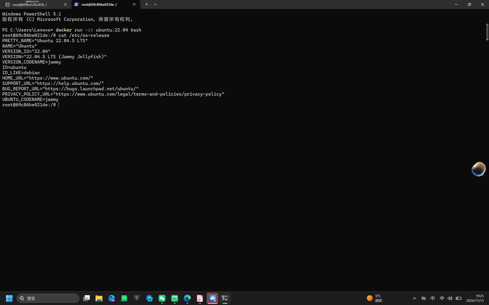
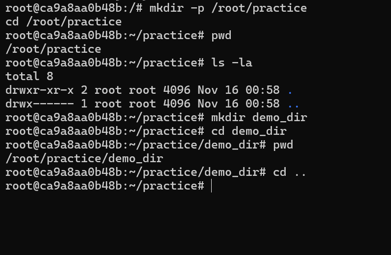
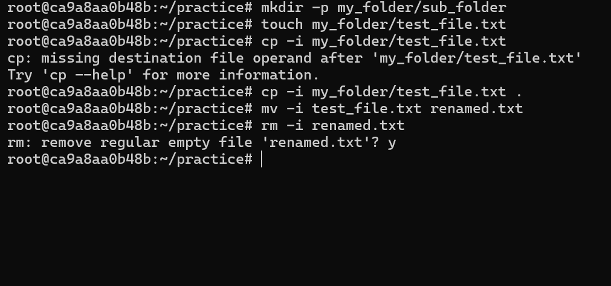
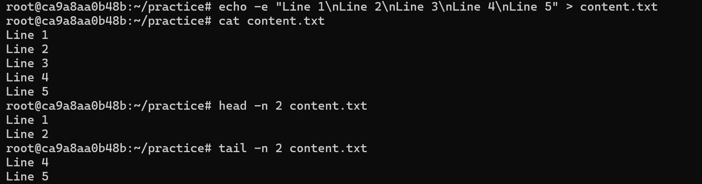
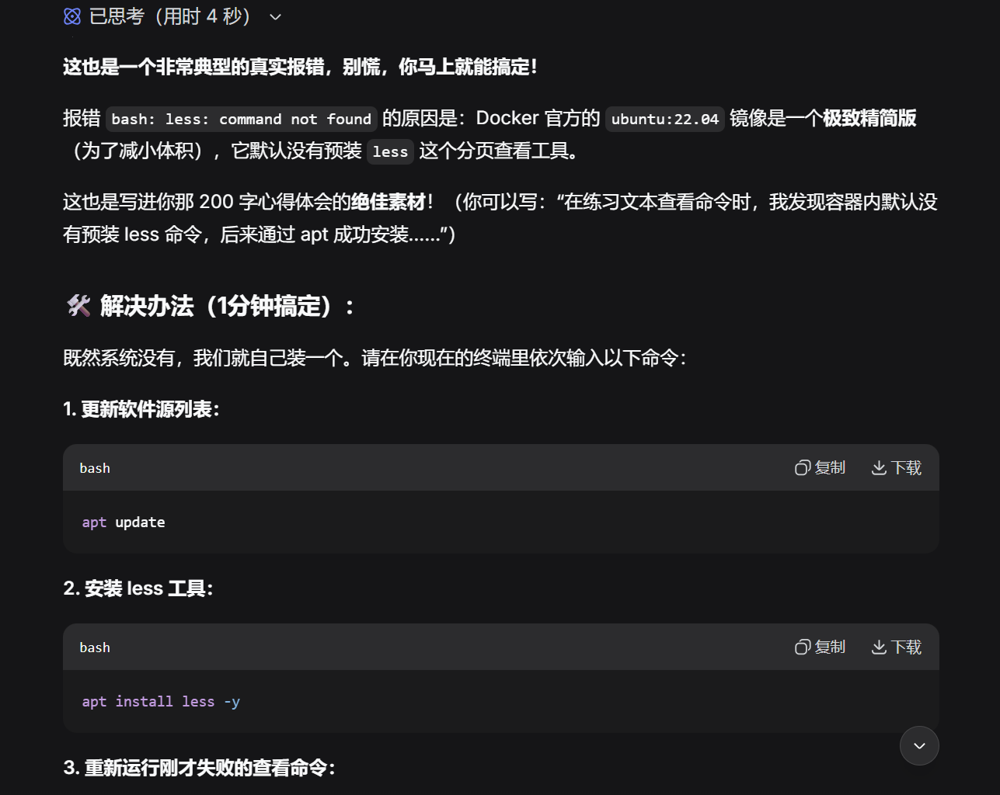

# 第二课作业：Ubuntu 环境搭建与命令练习

**姓名：** 你的真实姓名
**宿主机系统：** Windows 11
**环境搭建方式：** WSL 2 + Docker 容器
**Ubuntu 版本：** 22.04 LTS
**使用的 Agent 工具：** DeepSeek (或你用的工具)

## 一、 心得体会（约 200 字）
在此次实践中，deepseek帮我规划了环境搭建的步骤，操作由本人完成。配置初期，遇到了 Docker Hub 网络超时，在 Agent 的指导下，我修改了 daemon.json 配置国内镜像加速器，成功拉取了镜像。以及纯净版镜像未预装 `less` 命令的报错。通过 Agent 的分析和给出的 `apt install less` 方案，成功排查并解决了问题。在此次实践中，我对Ubuntu命令有了一个初步的认识，后续仍需在实践中增加理解。

## 二、 过程截图
### 1. Ubuntu 版本确认

### 2. 目录定位练习

### 3. 文件操作练习

### 4. 文本查看练习

### 5. Agent 协助过程

