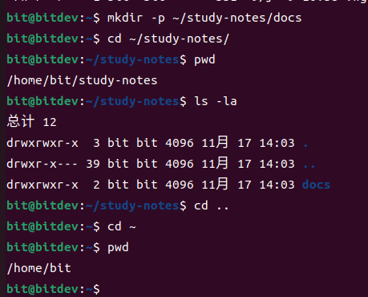
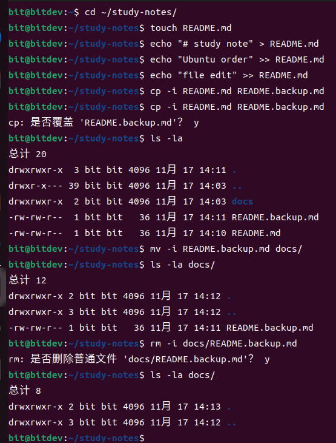
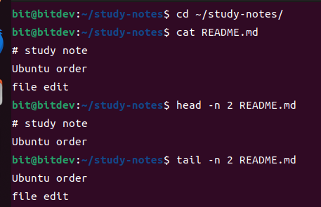
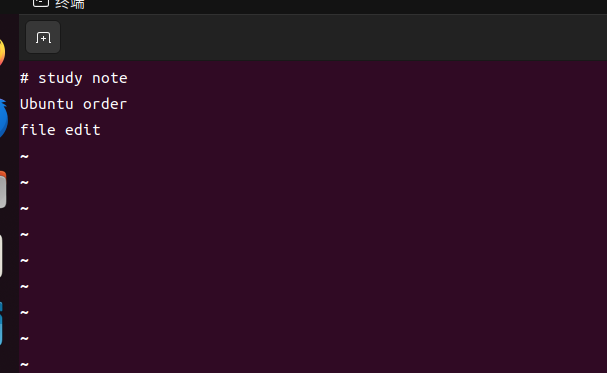
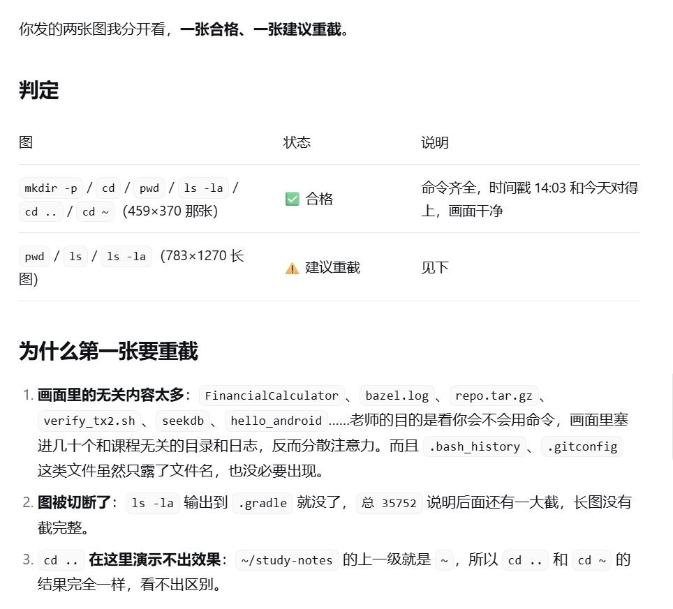

# 第二课作业：Ubuntu 22.04 命令练习

- 姓名：管铭宇
- 学号：1120240678
- 日期：2026-11-17

## 一、环境与工具

| 项目 | 内容 |
|---|---|
| 环境类型 | VMware 虚拟机（环境已事先安装，本次直接使用，未重新搭建） |
| 操作系统 | Ubuntu 22.04.3 LTS (Jammy Jellyfish) |
| 内核版本 | 6.8.0-138-generic |
| 终端 | GNOME Terminal |
| Agent 工具 | DeepSeek Harness 会话助手 |
| Agent 用途 | 读课程大纲、核对作业要求、给命令练习顺序、复查截图问题 |

版本信息见 `screenshots/01-env-version.png`

> 说明：作业允许虚拟机、Docker 容器等方式任选其一。本次使用已装好的 VMware 虚拟机，故未重复演示安装过程。
>
> 另：`lsb_release -a` 首行提示 `No LSB modules are available.`，属精简安装缺 lsb 模块的常规提示，不影响版本读取；已用 `cat /etc/os-release` 交叉确认版本一致。

## 二、命令练习

### 2.1 目录定位

在 `~/study-notes` 下用 `pwd` 确认当前位置，用 `ls` / `ls -la` 查看目录内容与权限，用 `cd` / `cd ..` / `cd ~` 在目录间跳转。



截图中：`pwd` 显示当前在 `/home/bit`；`mkdir -p ~/study-notes/docs` 一次建出两级目录，不会因上级目录不存在而报错；`ls -la` 里 `docs` 的权限为 `drwxrwxr-x`，是普通目录；最后用 `cd ..` 和 `cd ~` 回到主目录，再用 `pwd` 确认位置。

因为 `study-notes` 就建在主目录下，这两条命令在这里的落点相同——`~/study-notes` 的上一级正是 `~`。这也是 Agent 建议在中间加一步 `cd docs` 再 `cd ..` 的原因：那样才能看出"返回上一级"和"回到主目录"的区别。

### 2.2 文件操作

用 `touch` 建空文件，`echo >` 写入、`echo >>` 追加，`cp -i` 复制、`mv -i` 移动、`rm -i` 删除，每一步都带回显确认。



`cp -i` 执行到第二次时弹出 `是否覆盖 'README.backup.md'？`，`rm -i` 弹出 `是否删除普通文件`，输入 `y` 后才真正执行——这正是 `-i` 的作用：把不可逆的操作变成需要确认的操作。`mv -i` 没有提示，是因为目标目录为空、不涉及覆盖，属于正常行为。

### 2.3 文本查看

`cat` 看全文，`head -n 2` / `tail -n 2` 分别看首尾两行，`less` 分页阅读后按 `q` 退出。





`head -n 2` 输出前两行、`tail -n 2` 输出后两行，中间一行在两次输出里都出现，说明二者只是视角不同，并非重复执行。`less` 截图中左下方的 `~` 是分页器读到文件末尾的填充标记。

## 三、Agent 辅助过程

本次使用的 Agent 是 DeepSeek Harness 会话中的助手。整段作业里，它参与了三件事：

1. **判断已有环境要不要重做**：我先把"虚拟机早就装好了，还要不要按说明从头搭一遍"这个问题交给它。它读完课程大纲后给出的结论是：作业允许虚拟机、Docker 任选一种并注明即可，**只有"搭环境"这一步可以省，截图和心得的交付要求一项都不能少**，并提醒我第一步先跑 `lsb_release -a` 确认版本号必须是 22.04。

2. **给出可执行的练习顺序**：它把课程大纲里的命令按"目录定位 / 文件操作 / 文本查看"三类拆成可以直接照敲的顺序，并说明 `cp -i` 和 `rm -i` 的确认提示才是要截的重点、`less` 必须在退出前截屏。

3. **复查我的截图并指出问题**：我第一版目录定位截图把整个家目录都列了出来，混进大量与课程无关的目录和日志，长图还被截断；它逐条指出画面过杂、图被切断，以及 `cd ..` 与 `cd ~` 结果相同、体现不出"返回上一级"，建议把 `ls -la` 的范围收窄到 `~/study-notes`。收窄后的版本就是 2.1 节用的那张。



需要说明的是，Agent 给的是方向和检查项，**每条命令都是我在虚拟机里自己敲的**，截图、commit、push 与 PR 也由本人完成。

## 四、心得体会

环境本来就有，VMware 里装好的 Ubuntu 22.04.3，所以我先问 Agent 还用不用从头做。它读完大纲说：只有搭环境能省，截图和心得不能少，并提醒先跑 `lsb_release` 确认版本。

它帮得最实在的是两处：一是把三类命令拆成能照敲的顺序；二是我第一版目录截图把整个家目录都列了出来，混进一堆无关的日志和目录，长图还被截断，它指出该只查 `~/study-notes`，我按这个范围重截了。它还说明 `mv -i` 没弹提示是目标不存在、不涉及覆盖，不是命令写错。

另外 `lsb_release` 报 No LSB modules，我用 `/etc/os-release` 交叉确认才放心；`less` 退出后画面会还原，只能留在里面截。

收获是先 `pwd` 再动手、删前看清路径，Agent 的话要自己跑一遍才算数。

## 附：文件清单

```text
submissions/管铭宇/
  README.md
  screenshots/
    01-env-version.png    环境与版本信息
    02-directory.png      目录定位
    03-file-ops.png       文件操作
    04-text-view.png      文本查看（cat / head / tail）
    04-less.png           文本查看（less 分页）
    05-agent.png          Agent 辅助过程
```
