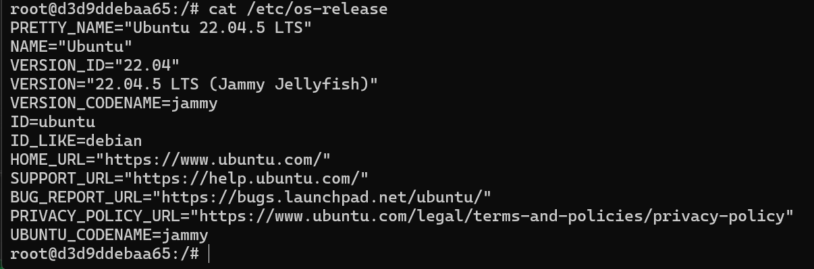
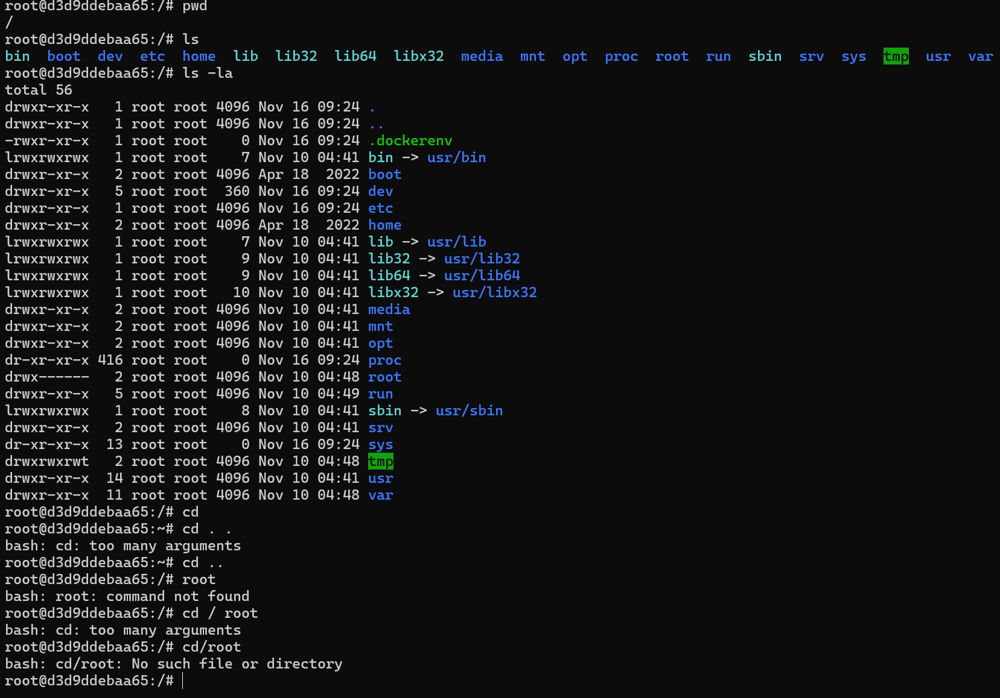
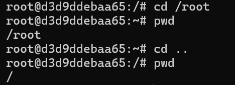
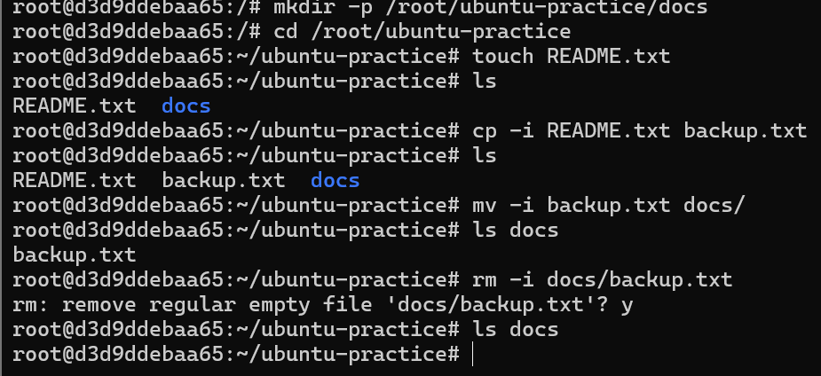
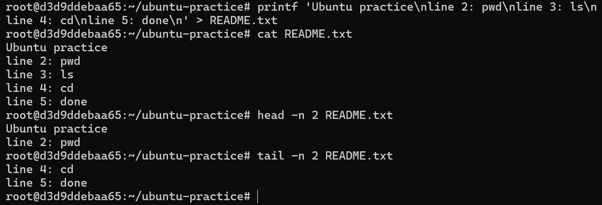

# 第二课作业：Ubuntu 环境搭建与 Agent 实践

## 基本信息

| 项目 | 内容 |
| --- | --- |
| 姓名 | 郑丁睿 |
| 学号 | 1120261358 |
| 宿主机系统 | Windows |
| 环境搭建方式 | Docker Desktop，使用 `ubuntu:22.04` 镜像创建 Ubuntu 容器 |
| Ubuntu 版本 | Ubuntu 22.04.5 LTS（`VERSION_ID="22.04"`） |
| 命令操作环境 | 容器内的 Bash 终端，使用 `root` 用户 |
| 专用练习目录 | `/root/ubuntu-practice` |
| Agent 工具 | ChatGPT 桌面端 |
| 模型与推理设置 | `6.1-sol`，`high` |

## 学习心得与遇到的问题

ChatGPT 真好用。从不清楚 Ubuntu 是干什么的，到用已有的 Docker 搭好环境、逐步练习命令，体验很好。尤其是针对性很强，找不到入口、多打空格，都能针对我的情况解释。GPT 告诉我该干什么，命令都是我手打的，顺便练练打字，不然 C 语言上机考试也是个问题（笑）。

遇到的最大的问题是空格。我原以为像 C 语言一样能比较随意地加，报错后才在 GPT 帮助下弄清命令、参数和路径的分隔。Docker 还不熟悉，这次只用了基础功能，深入学习先搁置了。Ubuntu 命令写起来有点麻烦，但打字时似乎感受到了一种美感，笑，感觉有很强的掌控感。

## 实践截图

### 1. Ubuntu 环境与版本

在 Ubuntu 容器内执行 `cat /etc/os-release`，确认版本为 Ubuntu 22.04.5 LTS。

### 2. 目录定位

练习 `pwd`、`ls`、`ls -la`、`cd` 和 `cd ..`。第一张保留了空格使用错误的实际报错，第二张展示修正后在 `/root` 与 `/` 之间切换的结果。

### 3. 文件操作

在专用练习目录中使用 `mkdir -p`、`touch`、`cp -i`、`mv -i` 和 `rm -i`，完成目录创建以及文件创建、复制、移动和删除。删除对象是自己创建的练习备份文件，输入 `y` 确认后，再用 `ls docs` 检查结果。

### 4. 文本查看

先向练习文件 `README.txt` 写入五行文本，再使用 `cat` 查看全部内容，使用 `head -n 2` 和 `tail -n 2` 分别查看前两行与后两行。

### 5. Agent 辅助过程

Agent 帮助解释空格导致的报错，提供修正方法和练习步骤，并说明命令的英文来源与选项含义；命令由本人输入并查看结果。

